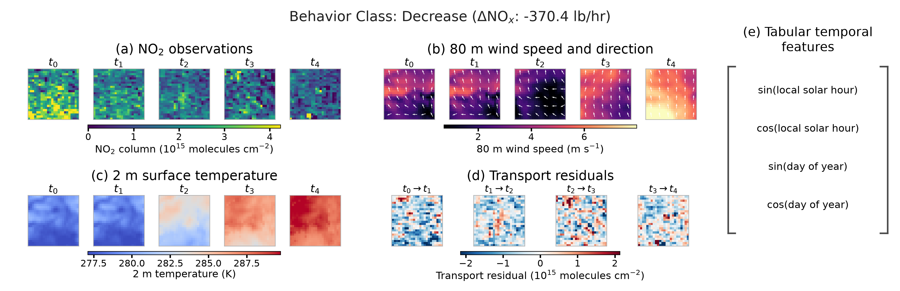
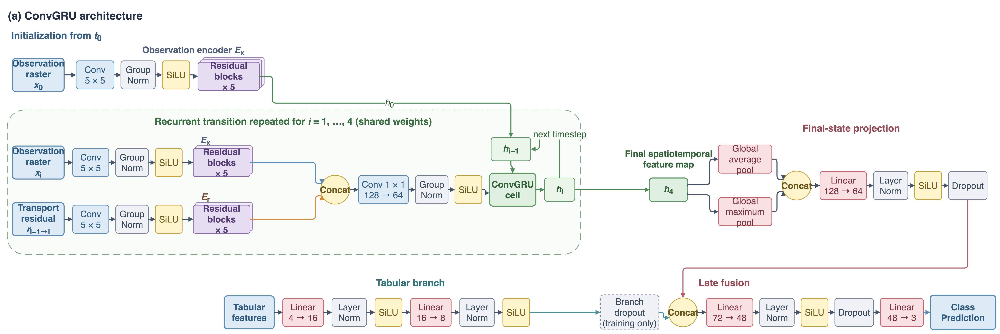
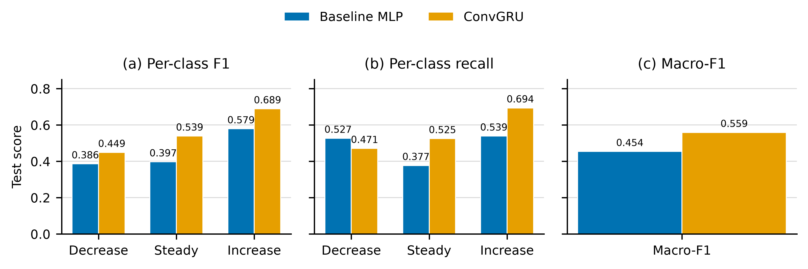

<h1 align="center">Detecting Changes in Power Plant NO<sub>x</sub> Emissions Using Deep Learning and TEMPO Satellite Imagery</h1>

<p align="center">Pranav Walimbe · Hikari Murayama · Ron Cohen</p>

<p align="center">
  <a href="https://eartharxiv.org/repository/view/15747/">
    
  </a>
</p>

Official implementation of [Detecting Changes in Power Plant NOx Emissions Using Deep Learning and TEMPO Satellite Imagery](https://eartharxiv.org/repository/view/15747/).

## TLDR

- TEMPO is a geostationary satellite from NASA that measures trace gas concentrations over North America on a hourly basis
- Satellite image based methods are useful for monitoring power plant emissions of pollutants like NOx
- We use deep learning on sequences of TEMPO images along with weather, transport, and temporal inputs to classify power plant NOx emissions trajectories as increasing, steady, or decreasing
- Our model identifies emissions signals beyond seasonal and daily patterns, suggesting sequential change detection may be a useful approach to satellite image based power plant monitoring

## Example Sequence

<p align="center">
  <a href="assets/paper/visuals/sample-construction.pdf">
    
  </a>
</p>

Example decrease-labeled sequence from an AOI centered on the Hugh L. Spurlock Generating Station in Maysville, Kentucky, on February 26, 2025. Panels show five NO2 observations, wind and temperature rasters, four transport residuals, and temporal features.

## Model Architecture

<p align="center">
  <a href="assets/paper/visuals/convgru-architecture.pdf">
    
  </a>
</p>

ConvGRU architecture. Separate convolutional encoders process observation rasters and transport residuals across five timesteps. The final hidden state is fused with temporal features to classify the emissions trajectory as increasing, steady, or decreasing.

## Results

<p align="center">
  <a href="assets/paper/visuals/classification-performance-test.pdf">
    
  </a>
</p>

Test performance on 22K+ sequences covering 116 active U.S. power plants. The baseline MLP uses only the four temporal features described above. Panels show per-class F1, per-class recall, and macro-F1.

## Setup + Usage

See the [setup and pipeline guide](assets/docs/setup_and_pipeline.md)

## Repo Layout

```text
.
├── src/
│   ├── config.py                    # Settings for full implementation
│   ├── data-scraping/               # Data collection and facility enrichment
│   └── delta-model/
│       ├── preprocessing/           # Mapping, splits, regridding, and dataset generation
│       └── modeling/                # Models, training, evaluation, HPO, and ablations
├── scripts/
│   ├── slurm/                       # Slurm scripts used to run the pipeline
│   └── visuals/                     # Visuals plotting scripts
└── assets/
    ├── docs/                        # Setup guide
    ├── paper/
    │   ├── paper.pdf
    │   └── visuals/                 # Visuals for preprint
    └── readme/                      # Visuals for readme
```

## Citation

```bibtex
@misc{walimbe2026tempochange,
  title = {Detecting Changes in Power Plant NOx Emissions Using Deep Learning and TEMPO Satellite Imagery},
  author = {Walimbe, Pranav and Murayama, Hikari and Cohen, Ronald C.},
  year = {2026},
  publisher = {EarthArXiv},
  doi = {10.31223/X50J7K},
  url = {https://eartharxiv.org/repository/view/15747/}
}
```
