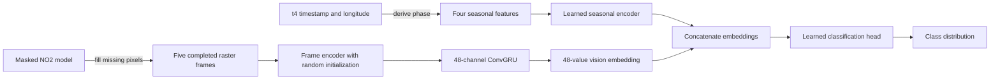

# Modeling

The delta-model trainer compares a seasonal classifier with a learned-fusion
classifier on the same geographic splits. The masked NO2 model fills missing
raster pixels before classifier training. Its encoder does not initialize the
vision model.

## Contract

| Component | Current choice |
|---|---|
| Target | Stored `delta_category` |
| Classes | `decrease`, `steady`, `increase`, mapped to 0, 1, and 2 |
| Raster sequence | Five completed frames with shape `5 x 4 x 24 x 24` |
| Raster channels | NO2, 2 m temperature, eastward wind, northward wind |
| Seasonal input | Local-solar-hour sine/cosine and day-of-year sine/cosine |
| Loss | Unweighted three-class cross-entropy |
| Prediction | Softmax distribution over the three classes |
| Checkpoint selection | Lowest validation cross-entropy for each model |
| Primary result | Jointly trained raster-seasonal embedding fusion classifier |

Dataset generation supplies the class label. The loader consumes that label
without recreating its construction.

## Seasonal features

The loader derives all four seasonal features from `t4_timestamp`, the final
scan aligned with the target. It shifts the UTC timestamp by `longitude / 15`
hours to obtain local solar time. Daily phase includes hour, minute, second, and
microsecond. Annual phase uses the resulting local-solar day of year plus the
fractional day and accounts for leap years. Training-split means and standard
deviations normalize the four derived values.

The seasonal model receives these inputs:

- `local_solar_hour_sin` and `local_solar_hour_cos`;
- `day_of_year_sin` and `day_of_year_cos`.

AOI score, city distance, unit counts, heat input, generation, latitude, and
longitude do not enter either classifier. The test-strata report uses selected
AOI characteristics after inference.

## Raster normalization and completion

Training loads the configured masked-model checkpoint before it builds the
classifier datasets. The masked model uses its checkpoint's global statistics
while it fills missing NO2 pixels. The vision classifier then converts the
completed NO2 channel to AOI-specific normalization while retaining the masked
model's global weather normalization:

| Channels | Center | Scale | Scope |
|---|---|---|---|
| NO2 | Median | `IQR / 1.349` | AOI-specific for classifier input |
| Temperature and wind | Mean | Population standard deviation | Global masked-model statistics |

The AOI statistics job samples up to 40 TEMPO rasters per calendar month for
each AOI in the finalized splits. It pools finite NO2 pixels and writes each
AOI's median and robust scale to `aoi-no2-normalization.json`.

The loader applies the masked-model normalization, clips values to `[-8, 8]`,
fills numeric gaps with zero, and appends `no2_mask` for reconstruction. The
masked autoencoder predicts NO2 at missing pixels and preserves observed
values. Training writes the four globally normalized completed channels to
split-specific memory-mapped arrays under the job-local `/tmp` directory. The
classifier loader converts completed NO2 back to physical units, applies the
record's AOI statistics, and clips the result to `[-8, 8]`.

Classifier training starts after completion finishes. Neither classifier sees
the validity mask, and the vision encoder starts from random weights.

## Models

### Seasonal classifier

The 291-parameter seasonal MLP maps four inputs through 16-value and 8-value
hidden representations before producing three logits. Training selects its
lowest-validation-loss checkpoint.

### Learned-fusion classifier

The trainer learns a separate seasonal encoder jointly with the raster branch.
A frame encoder maps each completed raster to a
`48 x 6 x 6` feature map. A 48-channel ConvGRU processes the five maps in time
order. Global average and maximum pooling feed a 48-value projection and a
48-value vision embedding. The model concatenates that embedding with an
8-value seasonal embedding and learns a shared 48-value classification head.
Both branches train end to end with unweighted hard cross-entropy.



## Optimization

Both classifiers use unweighted hard cross-entropy, AdamW, gradient clipping,
validation-loss scheduling, CUDA mixed precision, and early stopping. Defaults
allow 75 seasonal epochs and 100 fusion epochs. Training stops after 15 epochs
without a lower validation loss;
the scheduler halves the learning rate after 10 such epochs. The maintained
Slurm launcher uses a batch size of 128, a vision learning rate of `3e-4`, a
48-channel vision width, a 48-value head, 30% dropout, and seed 42.

Run the production workflow with:

```bash
sbatch scripts/slurm/train_model.sh
```

Direct module execution requires `--completed-raster-dir` under `/tmp` and
a valid `--pretrained-masked-model-weights` path.

## Evaluation and artifacts

Each model reports accuracy, balanced accuracy, macro F1, one-vs-rest macro
AUROC, class counts, per-class recall, and a three-class confusion matrix in
`results.json`.

The trainer produces three summary figures:

- `split_class_accuracy.png` shows labeled overall accuracy bars by split and
  labeled per-class recall bars within each split;
- `training_curves.png` shows train and validation loss for both models;
- `accuracy_by_characteristic.png` compares model accuracy across test-set
  average-heat-input and unit-count tertiles, plus calendar month for the test
  and validation splits.

The characteristic figure assigns average heat input and unit count at the
unique-AOI level. Month comes from each record's label-aligned final TEMPO
timestamp. Labels report learned-fusion accuracy minus seasonal accuracy.
`accuracy_by_characteristic.csv` stores the plotted split, counts,
stratification unit, value ranges, accuracies, and differences.

The run directory contains both best checkpoints, preprocessing state,
run configuration, and row-level predictions for each model and split.
